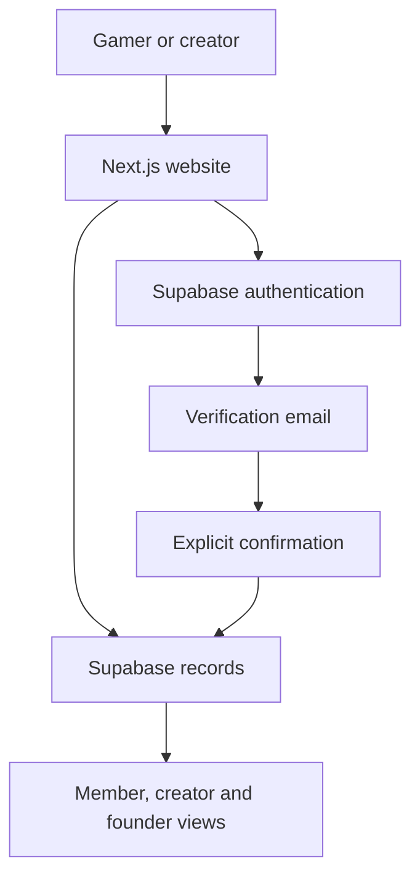
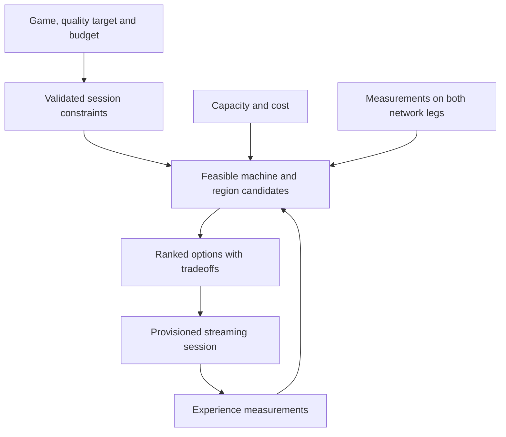

# Architecture and tradeoffs

## Documented pre-launch application

The September 2026 setup guide describes a Next.js application, Supabase authentication and persistence, and Resend email delivery. It describes founder and creator dashboards, gamer referrals, email-verification workflows, campaign tags, and database migrations. These are historical documentation claims, not a fresh source-code audit.

The diagram summarizes documented responsibilities. It is not a verified call graph.

### Product boundaries

- Submitted emails and verified memberships are different states.
- Repeating a verification or sign-in should not create a second reward.
- Creator attribution should survive changes in browser or device after verification.
- Creator-attributed acquisition should not also grant an unrelated gamer-referral reward.
- Private administration and public counters have different access needs.
- The documented payment ledger is preparation for a future integration, not evidence of processed purchases.

The supplied email template includes an expiry statement. Its text alone cannot enforce expiry; the authentication configuration and confirmation handler must do that.

## Proposed gaming system

This is a proposed design, not implemented architecture verified in this repository.

An intent assistant would interpret the player's request. Resource selection would still require explicit constraints, current availability and real measurements. An AI-generated assertion about a region's performance is insufficient to allocate a session confidently.

### Open engineering questions

1. Which game and region make a narrow first test feasible?
2. How will measurements distinguish network delay, encode/decode delay and frame pacing?
3. What happens when capacity disappears after an option is displayed?
4. How will game licensing, account access, anti-cheat compatibility and persistence be handled?
5. What is the measured cost of an acceptable session, including idle capacity and delivery costs?

Support for existing game libraries, mods and persistent environments would depend on game and platform compatibility and permissions. They are not universal guarantees.
